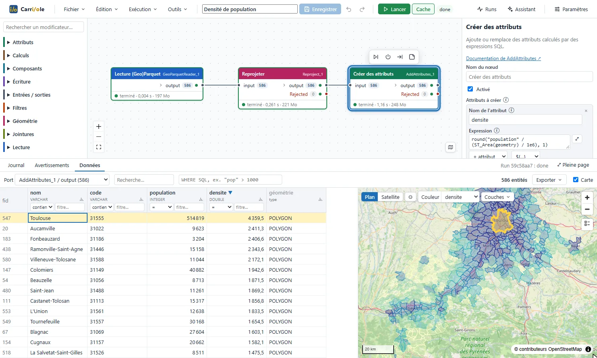
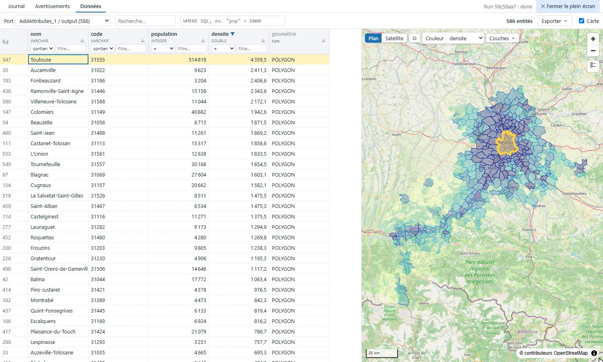
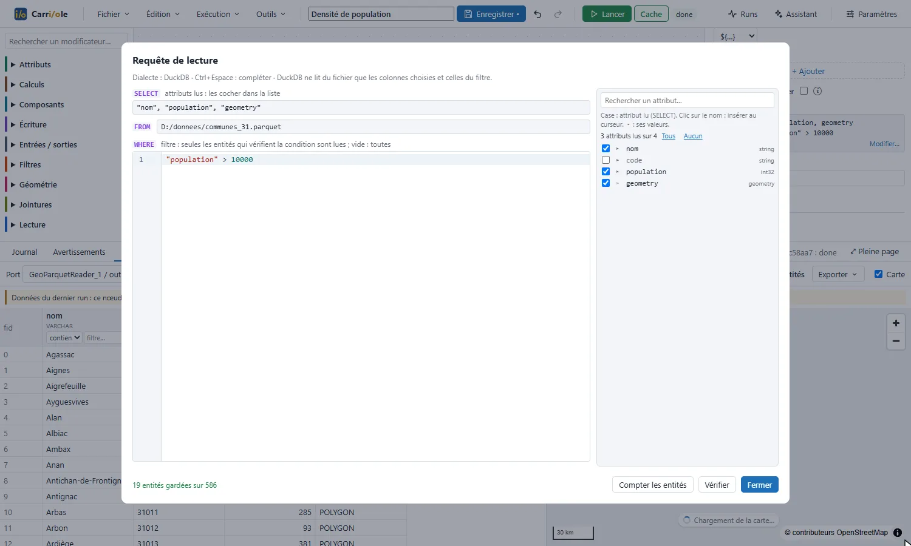

<p align="center"></p>

<h1 align="center">Carriole</h1>

<p align="center">ETL pour les données géographiques : application de bureau sous Windows et Linux, ou serveur
partagé dans le navigateur.<br>Les flux se construisent sur un canevas à partir de modificateurs ; la sortie de chaque
nœud se vérifie sur une table et une carte.</p>

<p align="center">
  <a href="https://tlecae.github.io/Carriole/">Site</a> ·
  <a href="https://github.com/TLecae/Carriole/releases/latest">Télécharger (Windows, Linux)</a> ·
  <a href="docs/guide_utilisateur.md">Guide de l'utilisateur</a> ·
  <a href="README.md">English</a>
</p>



[Vidéo](https://tlecae.github.io/Carriole/#video) : ce flux construit à partir d'un canevas vide, lancé, puis son
résultat inspecté.

Sur un poste, Carriole lit et écrit vos fichiers (`Z:`, `\\serveur\partage`) avec vos droits, sans serveur à
installer. Sur une machine partagée, plusieurs utilisateurs travaillent dans leur navigateur : voir
[Installer sur un serveur](#installer-sur-un-serveur).

> Plan et avancement : [docs/plan_jalons.md](docs/plan_jalons.md) et [docs/journal_jalons.md](docs/journal_jalons.md).

## Ce que ça fait

- **Formats**, en lecture et en écriture : PostgreSQL/PostGIS, GeoPackage, Shapefile, MapInfo, DXF (AutoCAD), GeoJSON,
  (Geo)Parquet (local ou en https), FlatGeobuf, CSV (WKT ou X/Y), Excel ; bases Oracle et SQLite / SpatiaLite ;
  rasters GeoTIFF / COG, JPEG 2000, NetCDF, catalogues STAC : [formats](docs/formats.md).
- **Une centaine de modificateurs** : attributs, filtres, jointures, statistiques ; géométrie (zone tampon,
  découpage, fusion, superposition de polygones, jointures spatiales, reprojection avec les grilles de l'IGN,
  validation…) ; rasters (calculatrice, relief, courbes de niveau, statistiques zonales…) : [catalogue](docs/catalogue.md).
- **Inspecteur** : la sortie de chaque nœud sur une table (filtres par colonne, tri, `WHERE` SQL) et sur une carte
  (couleurs selon un attribut, OpenStreetMap, photographies aériennes ou serveur de tuiles personnalisé), sélection
  partagée entre les deux. Les requêtes passent par DuckDB et la carte est dessinée en tuiles vectorielles : un gros
  jeu de données reste consultable.
- **Édition** : formulaires générés depuis les paramètres des modificateurs, aide sur chaque champ et lien vers le
  catalogue. Les éditeurs SQL et d'expressions proposent la complétion, la vérification, et la liste des attributs
  avec leurs valeurs les plus fréquentes.
- **Runs** en arrière-plan : nœuds en parallèle, mémoire limitée au budget réglé dans *Paramètres*. Le résultat de
  chaque nœud est gardé : le run suivant ne recalcule que ce qui a changé. Les runs se planifient (cron).
- **Des flux en fichiers JSON**, rangés où l'équipe veut ; composants partagés par un dossier commun.
- **Des modificateurs en Python** : un plugin est une classe dans un fichier ([écrire un modificateur](docs/ecrire_un_modificateur.md)).
- **Assistant IA** facultatif (Claude, OpenAI, OpenRouter, Ollama) : il lit le flux et propose des modifications que
  l'on applique d'un clic ; ce qu'il peut lire se règle : [ADR 0027](docs/decisions/0027-assistant-ia.md).
- **Français et anglais**, au choix dans les paramètres ([ADR 0023](docs/decisions/0023-internationalisation.md)).
- **Poste ou serveur** : en mode serveur (image Docker, exemple complet dans `docker/compose.yaml`), connexion
  par comptes locaux gérés par les administrateurs ; flux et connexions privés tant qu'ils
  ne sont pas partagés avec un utilisateur ou un groupe ; fichiers limités aux dossiers autorisés ; code Python des
  flux isolé (bubblewrap) ; file équitable et quotas par utilisateur ; journal d'activité ; métadonnées dans SQLite
  ou PostgreSQL ([guide du serveur](docs/serveur.md)).
- **Ligne de commande** `etl`, facultative : exécuter, valider, inspecter un fichier, piloter le serveur local.





## Installer sur un serveur

Chaque version publie une image Docker, `ghcr.io/tlecae/carriole`. Sur un serveur Linux avec Docker et son extension
Compose, rien d'autre n'est nécessaire (ni clone, ni construction) :

```bash
mkdir carriole && cd carriole
curl -fsSLO https://raw.githubusercontent.com/TLecae/Carriole/main/docker/compose.yaml
curl -fsSL -o carriole.env https://raw.githubusercontent.com/TLecae/Carriole/main/docker/carriole.env.example
nano carriole.env                      # ETL_ADMIN_PASSWORD : mot de passe du premier administrateur, « admin »
mkdir donnees && sudo chown 10001:10001 donnees   # dossier lu et écrit par les utilisateurs ; en root, sans sudo
docker compose pull && docker compose up -d
```

Carriole répond alors sur `http://127.0.0.1:8080` : se connecter avec `admin`, puis créer les comptes des
utilisateurs dans *Outils → Comptes*. Placer un proxy HTTPS (nginx, Caddy…) devant le port 8080 pour l'ouvrir au
réseau. Pour mettre à jour sans perdre ni flux ni comptes (sauvegarde, puis
`docker compose pull && docker compose up -d`) : [Mettre à jour](docs/serveur.md#mettre-à-jour). Un fichier `.env` à côté de `compose.yaml` porte
les variables de Compose : `CARRIOLE_VERSION=0.2.1` fixe une version, `CARRIOLE_DONNEES=/mnt/partage` monte un autre
dossier, `CARRIOLE_BIND=0.0.0.0` ouvre le port au réseau sans proxy (pour un essai : les mots de passe circulent alors
en clair). Dossiers autorisés, partage Windows, administrateurs, quotas, PostgreSQL :
[guide du serveur](docs/serveur.md).

## Documentation

| Pour… | Lire |
| --- | --- |
| Utiliser Carriole | [guide de l'utilisateur](docs/guide_utilisateur.md) · [English user guide](docs/en/user_guide.md) |
| Installer, régler (bouton Paramètres), utiliser `etl` en ligne de commande | [installation.md](docs/installation.md) |
| Écrire un modificateur en Python (un fichier) | [ecrire_un_modificateur.md](docs/ecrire_un_modificateur.md) |
| Installer sur un serveur partagé (plusieurs utilisateurs, comptes, dossiers autorisés) | [serveur.md](docs/serveur.md) |
| Sécurité | [securite.md](docs/securite.md) |
| Comprendre les choix | [décisions (ADR)](docs/decisions/) |

## Démarrage (développement)

Utilisateurs : [télécharger](https://github.com/TLecae/Carriole/releases/latest) l'installeur Windows
`Carriole-Setup-<version>.exe` (double-clic) ou l'AppImage Linux ; tout est embarqué (voir
[installation.md](docs/installation.md)). Ce qui suit concerne le code source.

Prérequis : [Git](https://git-scm.com/), [uv](https://docs.astral.sh/uv/) et Node.js 22 ou plus. Les commandes
sont les mêmes sous PowerShell et dans un terminal Linux.

Première fois : récupérer le code et le construire.

```powershell
git clone https://github.com/TLecae/Carriole.git
cd Carriole
uv sync              # environnement Python (dossier .venv)
cd frontend
npm ci               # dépendances de l'interface
npx vite build       # construit l'interface (frontend/dist), servie par le backend local
cd ..
```

Lancer, depuis le dossier `Carriole` :

```powershell
uv run etl open      # démarre le backend local et ouvre l'interface dans le navigateur
```

Ou la fenêtre de bureau (Electron) :

```powershell
cd desktop
npm ci               # la première fois et après chaque mise à jour
npm start
```

Mettre à jour, depuis le dossier `Carriole` (Carriole fermé) :

```powershell
git pull
uv sync
cd frontend
npm ci
npx vite build       # l'interface se reconstruit après chaque mise à jour
cd ..
```

Puis `npm ci` dans `desktop/` si vous utilisez la fenêtre de bureau. Pour contribuer, voir
[CONTRIBUTING.md](CONTRIBUTING.md).

## Structure

| Dossier | Rôle |
| --- | --- |
| `engine/` | moteur, SDK des modificateurs, CLI `etl` |
| `api/` | API FastAPI et backend local (`etl serve`) |
| `worker/` | exécution des runs (processus séparés) |
| `frontend/` | éditeur et inspecteur (React) |
| `desktop/` | application de bureau : Electron, installeur Windows (NSIS), AppImage Linux |
| `store/` | métadonnées locales : runs, connexions, planifications (SQLite) ; flux et composants en fichiers |
| `plugins/` | modificateurs ajoutés sans réinstaller |
| `bench/` | jeux synthétiques et mesures (1 M et 10 M d'entités) |
| `e2e/` | tests de bout en bout (Playwright) |
| `docs/` | guides, ADR, catalogue, journal, questions ouvertes |

## Tests et CI

```powershell
powershell -ExecutionPolicy Bypass -File scripts\ci.ps1     # lint, pytest, vitest, build, Playwright
```

PostgreSQL de test facultatif : `ETL_TEST_PG` (voir `.env.example`). Navigateur des tests de bout en bout : Edge
(livré avec Windows) ou Chromium (`E2E_CHANNEL=chromium`).

Captures et vidéo du site : `scripts\site_media.ps1` (rejoue `e2e/media`).

## Construit avec

Principales bibliothèques libres utilisées :

- **Moteur de données** : [DuckDB](https://duckdb.org) et son extension Spatial, [Apache Arrow](https://arrow.apache.org),
  [GDAL](https://gdal.org) (par [pyogrio](https://pyogrio.readthedocs.io) et
  [Rasterio](https://rasterio.readthedocs.io)), [Shapely](https://shapely.readthedocs.io) / GEOS,
  [PROJ](https://proj.org) / pyproj, [NumPy](https://numpy.org)
- **Bases de données** : [psycopg](https://www.psycopg.org), [python-oracledb](https://python-oracledb.readthedocs.io),
  SQLite, [SQLAlchemy](https://www.sqlalchemy.org)
- **Serveur local** : [FastAPI](https://fastapi.tiangolo.com), [Uvicorn](https://www.uvicorn.org),
  [Pydantic](https://docs.pydantic.dev), [Typer](https://typer.tiangolo.com)
- **Interface** : [React](https://react.dev), [React Flow](https://reactflow.dev),
  [MapLibre GL JS](https://maplibre.org), [CodeMirror](https://codemirror.net),
  [TanStack Virtual](https://tanstack.com/virtual), [i18next](https://www.i18next.com), [Zustand](https://zustand.docs.pmnd.rs),
  [Vite](https://vite.dev)
- **Application de bureau et paquets** : [Electron](https://www.electronjs.org),
  [electron-builder](https://www.electron.build), [uv](https://docs.astral.sh/uv/) et python-build-standalone
- **Cartes et données** : contributeurs [OpenStreetMap](https://www.openstreetmap.org/copyright), grilles de
  transformation de l'IGN

Liste complète avec les licences : [THIRD_PARTY_NOTICES.md](THIRD_PARTY_NOTICES.md).

## Confidentialité

Carriole ne transmet aucune information à d'autres systèmes en réseau, sauf demande expresse de l'utilisateur ou de
la personne qui l'installe ou l'exploite. Ce qu'il envoie, et quand :

- la carte de l'inspecteur charge le fond de plan choisi sur la carte (OpenStreetMap par défaut, Esri, IGN ou une
  adresse personnalisée), qui reçoit la zone affichée ; *Aucun (hors ligne)* le coupe ;
- les modificateurs qui appellent un service web (requête web, recherche STAC, géocodage…) envoient ce que le flux
  leur donne à l'adresse réglée dans leurs paramètres, pendant le run ;
- l'assistant IA, une fois un fournisseur configuré dans ses réglages, envoie à ce fournisseur le flux et ce que ses
  réglages de confidentialité permettent ([ADR 0027](docs/decisions/0027-assistant-ia.md)) ;
- les bases de données et les partages réseau sont lus et écrits comme les flux l'indiquent.

Carriole ne collecte aucune statistique d'usage et ne vérifie pas les mises à jour.

## Licence

[MIT](LICENSE) © Thomas Lecae. Composants tiers livrés : [THIRD_PARTY_NOTICES.md](THIRD_PARTY_NOTICES.md).
