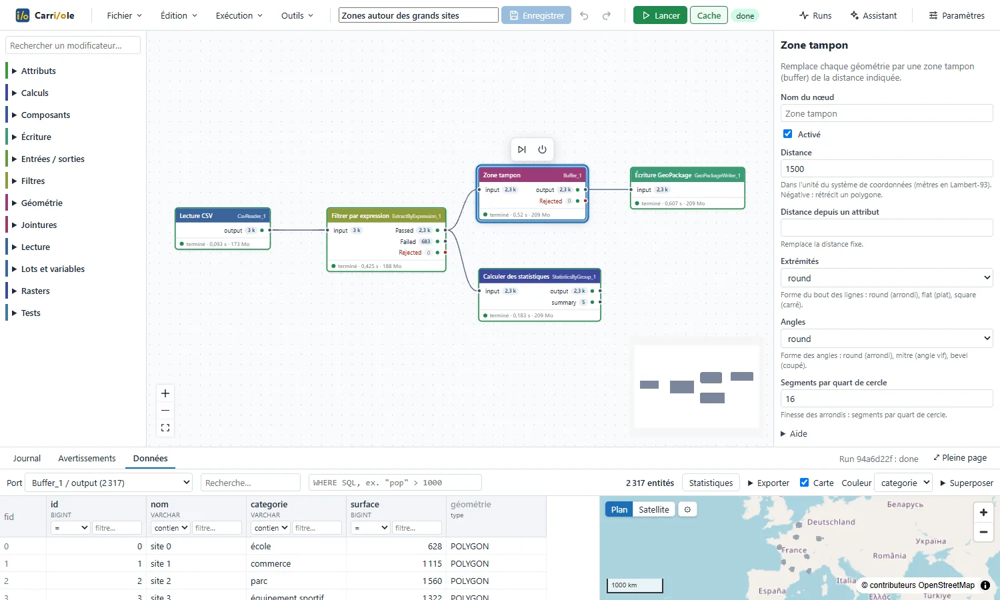

<p align="center"></p>

<h1 align="center">Carriole</h1>

<p align="center"><b>L'ETL pensé d'abord pour la donnée géographique.</b><br>On construit des traitements SIG en
branchant des modificateurs Python les uns aux autres dans un éditeur graphique, on les exécute en arrière-plan et on
inspecte chaque connexion sur une table et une carte synchronisées.</p>

<p align="center">
  <a href="https://tlecae.github.io/Carriole/">Site</a> ·
  <a href="https://github.com/TLecae/Carriole/releases/latest">Télécharger (Windows, Linux)</a> ·
  <a href="docs/guide_utilisateur.md">Guide de l'utilisateur</a> ·
  <a href="README.md">English</a>
</p>



Ici, la géométrie n'est pas une colonne parmi d'autres : chaque connexion transporte des entités avec leur système
de coordonnées, les modificateurs connaissent la géométrie, et tout résultat intermédiaire se regarde sur une carte.
Application de bureau (Windows, Linux) : elle lit et écrit vos fichiers (`Z:`, `\\serveur\partage`) avec vos droits.

> Plan et avancement : [docs/plan_jalons.md](docs/plan_jalons.md) et [docs/journal_jalons.md](docs/journal_jalons.md).

## Ce que ça fait

- **Éditeur graphique** : flux récents, palette, ajout rapide au clavier, formulaires générés depuis le code des
  modificateurs (aide et exemples sur chaque champ), dialogues de fichiers, annuler/rétablir, copier-coller, signets,
  annotations.
- **Des flux en fichiers JSON**, rangés où l'équipe veut ; composants partagés par un dossier commun.
- **104 modificateurs** (un lecteur et un écrivain par format de fichier, attributs, filtres, jointures, statistiques, géométrie, bases SQL (PostgreSQL, Oracle, SQLite), rasters et STAC…) : [catalogue](docs/catalogue.md).
- **Assistant IA** (Claude, OpenAI, OpenRouter, Ollama) : il lit le flux, les fichiers et les runs, et propose des modifications que l'on applique d'un clic ; confidentialité réglable : [ADR 0027](docs/decisions/0027-assistant-ia.md).
- **Formats géographiques** : PostgreSQL/PostGIS, GeoPackage, Shapefile, MapInfo, GeoJSON, GeoParquet, FlatGeobuf, CSV (WKT ou X/Y), Excel ; rasters GeoTIFF/COG, JPEG 2000, NetCDF, catalogues STAC : [formats](docs/formats.md).
- **Runs en arrière-plan** sur des workers (reprise, annulation, notification), planifiables (cron).
- **Français et anglais** : langue choisie à l'installation, modifiable dans les paramètres ([ADR 0023](docs/decisions/0023-internationalisation.md)).
- **Ligne de commande** `etl` : exécuter, valider, inspecter un fichier, piloter le backend local.
- **Inspecteur** : table filtrable et carte synchronisées (DuckDB), sur des millions d'entités.
- **Performance** : nœuds enchaînés en parallèle, mémoire bornée par run, plusieurs flux à la fois ([ADR 0028](docs/decisions/0028-performance-memoire-et-runs-paralleles.md)).

## Documentation

| Pour… | Lire |
| --- | --- |
| Utiliser Carriole | [guide de l'utilisateur](docs/guide_utilisateur.md) · [English user guide](docs/en/user_guide.md) |
| Installer, régler (bouton Paramètres), utiliser `etl` en ligne de commande | [installation.md](docs/installation.md) |
| Écrire un modificateur en Python (un fichier) | [ecrire_un_modificateur.md](docs/ecrire_un_modificateur.md) |
| Sécurité | [securite.md](docs/securite.md) |
| Comprendre les choix | [décisions (ADR)](docs/decisions/) |

## Démarrage (développement)

Prérequis : [uv](https://docs.astral.sh/uv/) et Node.js 22 ou plus.

```powershell
uv sync                                  # environnement Python
cd frontend; npm ci; npx vite build      # interface
.\.venv\Scripts\etl.exe open             # démarre le backend local et ouvre l'interface
```

Utilisateurs : [télécharger](https://github.com/TLecae/Carriole/releases/latest) l'installeur Windows
`Carriole-Setup-<version>.exe` (double-clic) ou l'AppImage Linux ; tout est embarqué (voir [installation.md](docs/installation.md)). Fenêtre de bureau en développement : `cd desktop; npm ci; npm start`.

## Structure

| Dossier | Rôle |
| --- | --- |
| `engine/` | moteur, SDK des modificateurs, CLI `etl` |
| `api/` | API FastAPI et backend local (`etl serve`) |
| `worker/` | exécution des runs (processus séparés) |
| `frontend/` | éditeur et inspecteur (React) |
| `desktop/` | application de bureau : Electron, installeur Windows (NSIS), AppImage Linux |
| `store/` | métadonnées locales : runs, connexions, planifications (SQLite) ; flux et composants en fichiers |
| `plugins/` | modificateurs ajoutés sans réinstaller |
| `bench/` | jeux synthétiques et mesures (1 M et 10 M d'entités) |
| `e2e/` | tests de bout en bout (Playwright) |
| `docs/` | guides, ADR, catalogue, journal, questions ouvertes |

## Tests et CI

```powershell
powershell -ExecutionPolicy Bypass -File scripts\ci.ps1     # lint, pytest, vitest, build, Playwright
```

PostgreSQL de test facultatif : `ETL_TEST_PG` (voir `.env.example`). Navigateur des tests de bout en bout : Edge
(livré avec Windows) ou Chromium (`E2E_CHANNEL=chromium`).

## Construit avec

Principales bibliothèques libres utilisées :

- **Moteur de données** : [DuckDB](https://duckdb.org) et son extension Spatial, [Apache Arrow](https://arrow.apache.org),
  [GDAL](https://gdal.org) (par [pyogrio](https://pyogrio.readthedocs.io) et
  [Rasterio](https://rasterio.readthedocs.io)), [Shapely](https://shapely.readthedocs.io) / GEOS,
  [PROJ](https://proj.org) / pyproj, [NumPy](https://numpy.org)
- **Bases de données** : [psycopg](https://www.psycopg.org), [python-oracledb](https://python-oracledb.readthedocs.io),
  SQLite, [SQLAlchemy](https://www.sqlalchemy.org)
- **Serveur local** : [FastAPI](https://fastapi.tiangolo.com), [Uvicorn](https://www.uvicorn.org),
  [Pydantic](https://docs.pydantic.dev), [Typer](https://typer.tiangolo.com)
- **Interface** : [React](https://react.dev), [React Flow](https://reactflow.dev),
  [MapLibre GL JS](https://maplibre.org), [CodeMirror](https://codemirror.net),
  [TanStack Virtual](https://tanstack.com/virtual), [i18next](https://www.i18next.com), [Zustand](https://zustand.docs.pmnd.rs),
  [Vite](https://vite.dev)
- **Application de bureau et paquets** : [Electron](https://www.electronjs.org),
  [electron-builder](https://www.electron.build), [uv](https://docs.astral.sh/uv/) et python-build-standalone
- **Cartes et données** : contributeurs [OpenStreetMap](https://www.openstreetmap.org/copyright), grilles de
  transformation de l'IGN

Liste complète avec les licences : [THIRD_PARTY_NOTICES.md](THIRD_PARTY_NOTICES.md).

## Licence

[MIT](LICENSE) © Thomas Lecae. Composants tiers livrés : [THIRD_PARTY_NOTICES.md](THIRD_PARTY_NOTICES.md).
