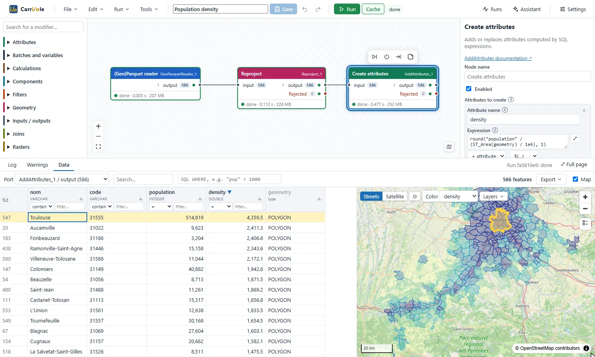
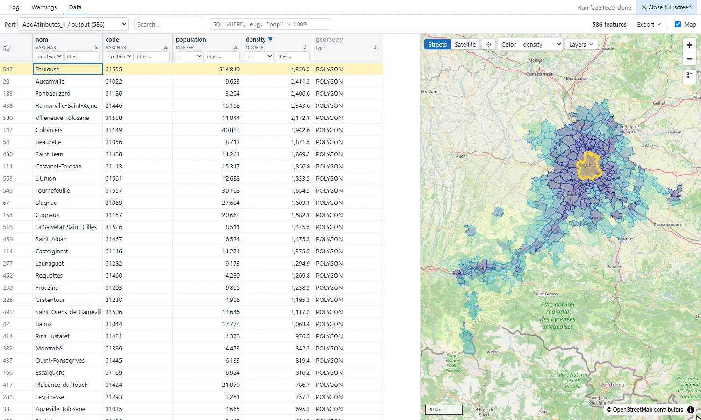
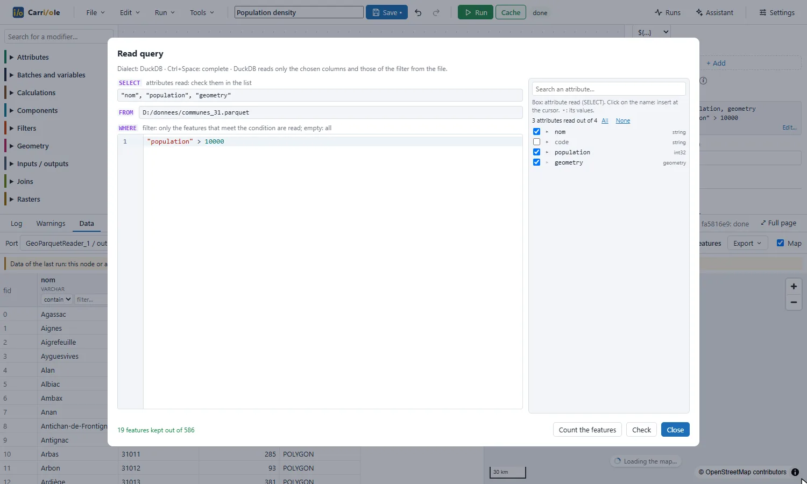

<p align="center"></p>

<h1 align="center">Carriole</h1>

<p align="center">Desktop ETL for geographic data, on Windows and Linux.<br>Flows are built on a canvas from
modifiers; the output of every node can be checked on a table and a map.</p>

<p align="center">
  <a href="https://github.com/TLecae/Carriole/releases/latest"></a>
  <a href="LICENSE"></a>
  <a href="https://github.com/TLecae/Carriole/actions/workflows/ci.yml"></a>
</p>

<p align="center">
  <a href="https://tlecae.github.io/Carriole/">Website</a> ·
  <a href="https://github.com/TLecae/Carriole/releases/latest">Download (Windows, Linux)</a> ·
  <a href="docs/en/user_guide.md">User guide</a> ·
  <a href="README.fr.md">Français</a>
</p>



[Video, 1 min](https://tlecae.github.io/Carriole/#video): this flow built from an empty canvas, run, then its result
inspected.

## Features

- **Formats**, read and written: PostgreSQL/PostGIS, GeoPackage, Shapefile, MapInfo (TAB, MIF), GeoJSON,
  (Geo)Parquet (local or over https), FlatGeobuf, CSV with WKT or X/Y columns, Excel; Oracle and SQLite / SpatiaLite
  databases. [Formats](docs/formats.md)
- **About a hundred modifiers**: attributes, filters, joins, statistics; vector geometry (buffer, clip, dissolve,
  polygon overlay, spatial joins, reprojection with the IGN grids, validation…); rasters (GeoTIFF / COG, JPEG 2000,
  NetCDF, STAC search; calculator, terrain analysis, contours, zonal statistics…). [Catalogue](docs/en/catalogue.md)
- **Inspector**: the output of any node on a table (column filters, sorting, SQL `WHERE`) and a map (colors by
  attribute, OpenStreetMap, satellite imagery or your own tile server), with the selection shared between the two.
  Queries run in DuckDB and the map is drawn from vector tiles, so large datasets stay usable.
- **Editing**: forms generated from the modifiers' parameters, with help on each field and a link to the catalogue.
  SQL and expression editors offer completion, error checking, and the list of attributes with their most frequent
  values.
- **Runs** in the background, with nodes in parallel and memory limited to the budget set in *Settings*. Each node's
  result is kept: the next run only recomputes what changed. Runs can be scheduled.
- **Flows are JSON files**, stored wherever the team wants; reusable components are shared through a folder.
- **Modifiers are Python files**: a plugin is one class in one file (see below).
- **AI assistant**, optional (Claude, OpenAI, OpenRouter, Ollama): it reads the flow and proposes changes, applied in
  one click; what it may read is configurable. [ADR 0027](docs/decisions/0027-assistant-ia.md)
- Runs on the user's computer, with their own permissions on local drives and network shares; no server to install.
  Interface in English and French.





Data shown: communes of Haute-Garonne with their population, from the API Géo of Etalab (Licence Ouverte).

## Install

Download from the [latest release](https://github.com/TLecae/Carriole/releases/latest):

| System | File | |
| --- | --- | --- |
| Windows 10/11 (x64) | `Carriole-Setup-<version>.exe` | Installer for all users of the computer. It is not code-signed: on the SmartScreen warning, click *More info* → *Run anyway*. |
| Linux (x64) | `Carriole-<version>-x86_64.AppImage` | `chmod +x` the file and run it: no installation, no admin rights. |

Everything is bundled (Python, GDAL, DuckDB Spatial, PROJ grids): no Internet access is needed to work.
More in the [installation guide](docs/installation.md) (French).

## Write a modifier

A modifier is one Python class in one file. Its parameters become a form in the editor; it receives batches of
features (Arrow tables, geometry as WKB) and returns one batch per output port.

```python
class SurfaceCalculator(Modifier):
    name = "SurfaceCalculator"
    label = "Surface area"
    category = "Geometry"
    inputs = ("input",)
    outputs = ("output",)

    class Params(Params):
        attribute: str = "surface"
        unit: Literal["m2", "ha"] = "m2"  # a drop-down list in the form

    def process(self, batch: pa.Table) -> dict[str, pa.Table]:
        area = shapely.area(geometries(batch))
        if self.params.unit == "ha":
            area = area / 10_000
        return {"output": batch.append_column(self.params.attribute, pa.array(area))}
```

Drop the file in your plugins folder: it appears in the palette, no rebuild needed. Full example with rejected
features and output schema: [examples/modifiers/surface_calculator.py](examples/modifiers/surface_calculator.py).
Guide: [writing a modifier](docs/ecrire_un_modificateur.md) (French).

## Develop

Requirements: [uv](https://docs.astral.sh/uv/) and Node.js 22+.

```bash
uv sync                                   # Python environment
cd frontend && npm ci && npx vite build   # user interface
cd ..
uv run etl open                           # starts the local backend and opens the UI in the browser
cd desktop && npm ci && npm start         # or the desktop window (Electron)
```

| Folder | Role |
| --- | --- |
| `engine/` | engine, modifier SDK, `etl` command line |
| `api/` | FastAPI API and local backend (`etl serve`) |
| `worker/` | run execution (separate processes) |
| `frontend/` | editor and inspector (React, React Flow, MapLibre) |
| `desktop/` | desktop application (Electron): Windows installer (NSIS), Linux AppImage |
| `store/` | local metadata: runs, connections, schedules (SQLite) |
| `assistant/` | AI assistant |
| `docs/` | guides, architecture decision records (ADR), catalogue |

Tests: `uv run pytest engine api store worker assistant -m "not slow"`; on Windows, `scripts\ci.ps1` runs the whole
chain including Playwright. Website screenshots and video: `scripts\site_media.ps1` (replays
`e2e/media`). See [CONTRIBUTING.md](CONTRIBUTING.md). Most developer documentation and code comments are
in French; issues and pull requests are welcome in English or French.

## Built with

Main open source libraries used:

- **Data engine**: [DuckDB](https://duckdb.org) and its Spatial extension, [Apache Arrow](https://arrow.apache.org),
  [GDAL](https://gdal.org) (through [pyogrio](https://pyogrio.readthedocs.io) and
  [Rasterio](https://rasterio.readthedocs.io)), [Shapely](https://shapely.readthedocs.io) / GEOS,
  [PROJ](https://proj.org) / pyproj, [NumPy](https://numpy.org)
- **Databases**: [psycopg](https://www.psycopg.org), [python-oracledb](https://python-oracledb.readthedocs.io),
  SQLite, [SQLAlchemy](https://www.sqlalchemy.org)
- **Backend**: [FastAPI](https://fastapi.tiangolo.com), [Uvicorn](https://www.uvicorn.org),
  [Pydantic](https://docs.pydantic.dev), [Typer](https://typer.tiangolo.com)
- **Interface**: [React](https://react.dev), [React Flow](https://reactflow.dev),
  [MapLibre GL JS](https://maplibre.org), [CodeMirror](https://codemirror.net),
  [TanStack Virtual](https://tanstack.com/virtual), [i18next](https://www.i18next.com), [Zustand](https://zustand.docs.pmnd.rs),
  [Vite](https://vite.dev)
- **Desktop and packaging**: [Electron](https://www.electronjs.org), [electron-builder](https://www.electron.build),
  [uv](https://docs.astral.sh/uv/) and python-build-standalone
- **Maps and data**: [OpenStreetMap](https://www.openstreetmap.org/copyright) contributors, IGN transformation grids

Full list with licenses: [THIRD_PARTY_NOTICES.md](THIRD_PARTY_NOTICES.md).

## Privacy

Carriole will not transfer any information to other networked systems unless specifically requested by the user or
the person installing or operating it. What it sends, and when:

- the inspector map loads its background from the basemap chosen on the map (OpenStreetMap by default, Esri, IGN, or
  a custom address), which receives the area shown; *None (offline)* turns it off;
- modifiers that call a web service (web request, STAC search, geocoding…) send what the flow gives them to the
  address set in their parameters, when the flow runs;
- the AI assistant, once a provider is set up in its settings, sends that provider the flow and what its privacy
  settings allow ([ADR 0027](docs/decisions/0027-assistant-ia.md));
- databases and network shares are read and written as the flows say.

Carriole collects no usage statistics and does not check for updates.

## License

[MIT](LICENSE) © Thomas Lecae. Bundled third-party components: [THIRD_PARTY_NOTICES.md](THIRD_PARTY_NOTICES.md).
