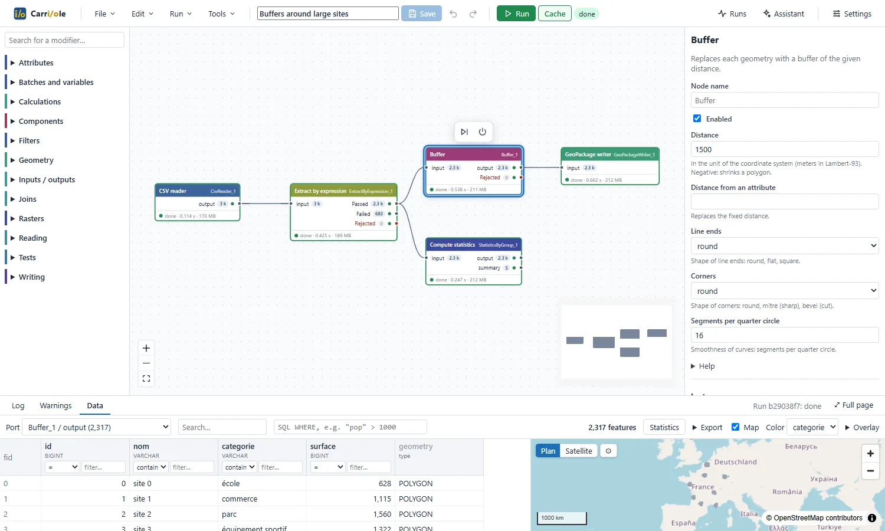
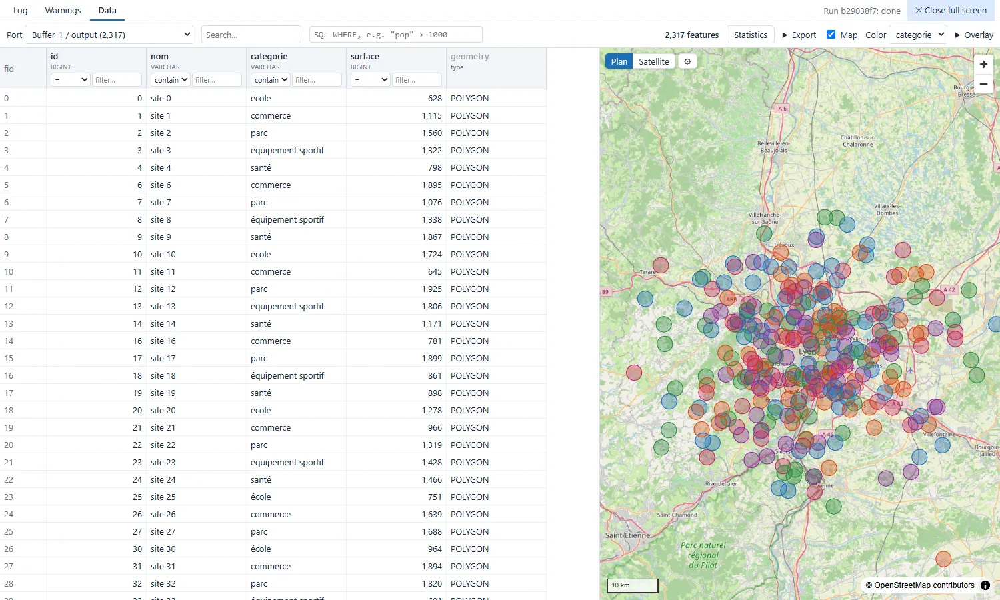

<p align="center"></p>

<h1 align="center">Carriole</h1>

<p align="center"><b>The geospatial-first ETL.</b><br>Build GIS data pipelines by wiring Python modifiers together in
a visual editor, run them in the background, and inspect every connection on a synchronized table and map.</p>

<p align="center">
  <a href="https://github.com/TLecae/Carriole/releases/latest"></a>
  <a href="LICENSE"></a>
  <a href="https://github.com/TLecae/Carriole/actions/workflows/ci.yml"></a>
</p>

<p align="center">
  <a href="https://tlecae.github.io/Carriole/">Website</a> ·
  <a href="https://github.com/TLecae/Carriole/releases/latest">Download (Windows, Linux)</a> ·
  <a href="docs/en/user_guide.md">User guide</a> ·
  <a href="README.fr.md">Français</a>
</p>



## Why Carriole

In Carriole, geometry is not an afterthought. Every connection carries features with their coordinate reference
system, modifiers are geometry-aware, and any intermediate result can be looked at on a map. It is a desktop
application for GIS teams who want visual workflows with modifiers that are
plain Python files they can read and write.

- **Spatial formats, read and written**: PostgreSQL/PostGIS, GeoPackage, Shapefile, MapInfo (TAB, MIF), GeoJSON,
  GeoParquet, FlatGeobuf, CSV with WKT or X/Y columns, Excel; Oracle and SQLite / SpatiaLite databases.
  [Formats](docs/formats.md)
- **Vector processing**: buffer, clip, dissolve, spatial relations and filters, point-on-area overlay, reprojection
  (official French IGN grids bundled), geometry validation, vertices, centroids, area… next to attributes, filters,
  joins and statistics. **104 modifiers**: [catalogue](docs/en/catalogue.md).
- **Rasters**: GeoTIFF, Cloud-Optimized GeoTIFF, JPEG 2000, NetCDF, STAC search; raster calculator, terrain analysis,
  contours, clip, mosaic, reproject, resample, reclassify, rasterize, polygonize, zonal statistics.
- **Inspector**: click any port to see its features on a filterable table and a map (OpenStreetMap, satellite or your
  own tile servers). Computed by DuckDB Spatial, smooth on millions of features.
- **Visual editor**: palette, keyboard quick add, forms generated from the modifiers' code (with help and examples),
  undo/redo, copy/paste, bookmarks, annotations, reusable components.
- **Flows are JSON files**, stored wherever your team wants; shared components live in a common folder.
- **Background runs**: parallel nodes, bounded memory, cancel and resume from cache, notifications, scheduling (cron).
- **AI assistant** (Claude, OpenAI, OpenRouter, Ollama): reads the flow, files and runs, and proposes changes you apply
  in one click; what is sent to the model is configurable. [ADR 0027](docs/decisions/0027-assistant-ia.md)
- **Your files, your permissions**: runs on your computer and reads and writes local drives and network shares as you.
  No server to administer. English and French interface.



## Install

Download from the [latest release](https://github.com/TLecae/Carriole/releases/latest):

| System | File | |
| --- | --- | --- |
| Windows 10/11 (x64) | `Carriole-Setup-<version>.exe` | Installer for all users of the computer. It is not code-signed: on the SmartScreen warning, click *More info* → *Run anyway*. |
| Linux (x64) | `Carriole-<version>-x86_64.AppImage` | `chmod +x` the file and run it: no installation, no admin rights. |

Everything is bundled (Python, GDAL, DuckDB Spatial, PROJ grids): no Internet access is needed to work.
More in the [installation guide](docs/installation.md) (French).

## Write a modifier

A modifier is one Python class in one file. Its parameters become a form in the editor; it receives batches of
features (Arrow tables, geometry as WKB) and returns one batch per output port.

```python
class SurfaceCalculator(Modifier):
    name = "SurfaceCalculator"
    label = "Surface area"
    category = "Geometry"
    inputs = ("input",)
    outputs = ("output",)

    class Params(Params):
        attribute: str = "surface"
        unit: Literal["m2", "ha"] = "m2"  # a drop-down list in the form

    def process(self, batch: pa.Table) -> dict[str, pa.Table]:
        area = shapely.area(geometries(batch))
        if self.params.unit == "ha":
            area = area / 10_000
        return {"output": batch.append_column(self.params.attribute, pa.array(area))}
```

Drop the file in your plugins folder: it appears in the palette, no rebuild needed. Full example with rejected
features and output schema: [examples/modifiers/surface_calculator.py](examples/modifiers/surface_calculator.py).
Guide: [writing a modifier](docs/ecrire_un_modificateur.md) (French).

## Develop

Requirements: [uv](https://docs.astral.sh/uv/) and Node.js 22+.

```bash
uv sync                                   # Python environment
cd frontend && npm ci && npx vite build   # user interface
uv run etl open                           # starts the local backend and opens the UI in the browser
cd desktop && npm ci && npm start         # or the desktop window (Electron)
```

| Folder | Role |
| --- | --- |
| `engine/` | engine, modifier SDK, `etl` command line |
| `api/` | FastAPI API and local backend (`etl serve`) |
| `worker/` | run execution (separate processes) |
| `frontend/` | editor and inspector (React, React Flow, MapLibre) |
| `desktop/` | desktop application (Electron): Windows installer (NSIS), Linux AppImage |
| `store/` | local metadata: runs, connections, schedules (SQLite) |
| `assistant/` | AI assistant |
| `docs/` | guides, architecture decision records (ADR), catalogue |

Tests: `uv run pytest engine api store worker assistant -m "not slow"`; on Windows, `scripts\ci.ps1` runs the whole
chain including Playwright. See [CONTRIBUTING.md](CONTRIBUTING.md). Most developer documentation and code comments are
in French; issues and pull requests are welcome in English or French.

## Built with

Main open source libraries used:

- **Data engine**: [DuckDB](https://duckdb.org) and its Spatial extension, [Apache Arrow](https://arrow.apache.org),
  [GDAL](https://gdal.org) (through [pyogrio](https://pyogrio.readthedocs.io) and
  [Rasterio](https://rasterio.readthedocs.io)), [Shapely](https://shapely.readthedocs.io) / GEOS,
  [PROJ](https://proj.org) / pyproj, [NumPy](https://numpy.org)
- **Databases**: [psycopg](https://www.psycopg.org), [python-oracledb](https://python-oracledb.readthedocs.io),
  SQLite, [SQLAlchemy](https://www.sqlalchemy.org)
- **Backend**: [FastAPI](https://fastapi.tiangolo.com), [Uvicorn](https://www.uvicorn.org),
  [Pydantic](https://docs.pydantic.dev), [Typer](https://typer.tiangolo.com)
- **Interface**: [React](https://react.dev), [React Flow](https://reactflow.dev),
  [MapLibre GL JS](https://maplibre.org), [CodeMirror](https://codemirror.net),
  [TanStack Virtual](https://tanstack.com/virtual), [i18next](https://www.i18next.com), [Zustand](https://zustand.docs.pmnd.rs),
  [Vite](https://vite.dev)
- **Desktop and packaging**: [Electron](https://www.electronjs.org), [electron-builder](https://www.electron.build),
  [uv](https://docs.astral.sh/uv/) and python-build-standalone
- **Maps and data**: [OpenStreetMap](https://www.openstreetmap.org/copyright) contributors, IGN transformation grids

Full list with licenses: [THIRD_PARTY_NOTICES.md](THIRD_PARTY_NOTICES.md).

## License

[MIT](LICENSE) © Thomas Lecae. Bundled third-party components: [THIRD_PARTY_NOTICES.md](THIRD_PARTY_NOTICES.md).
